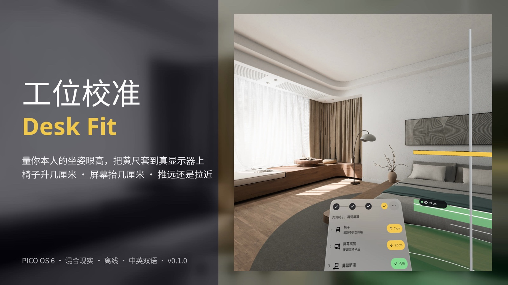
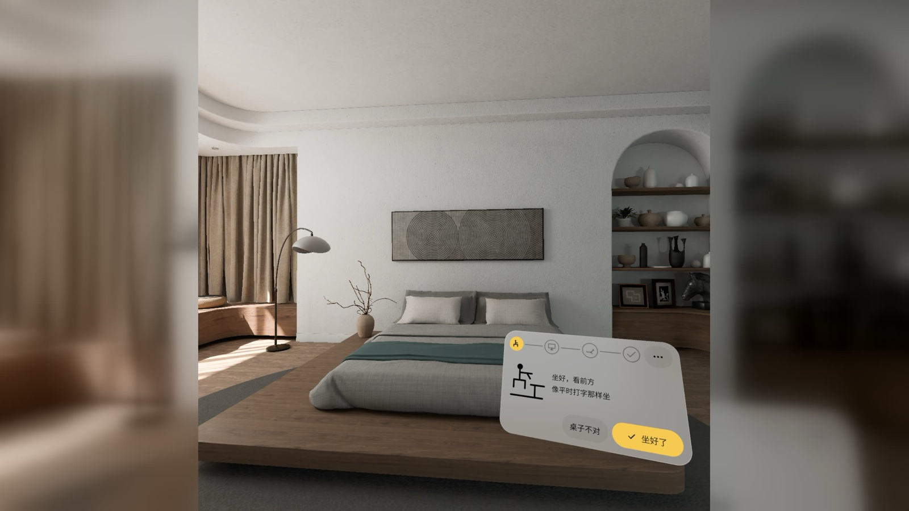
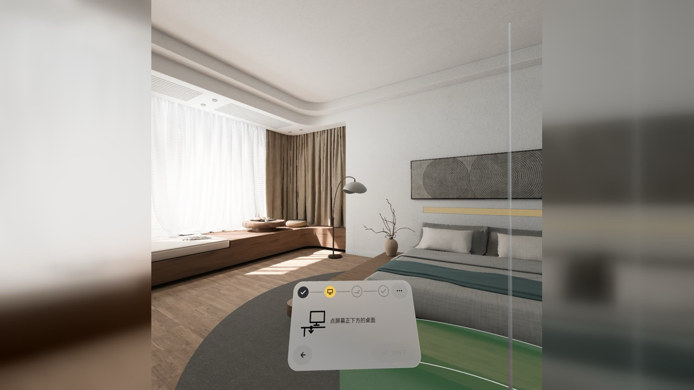
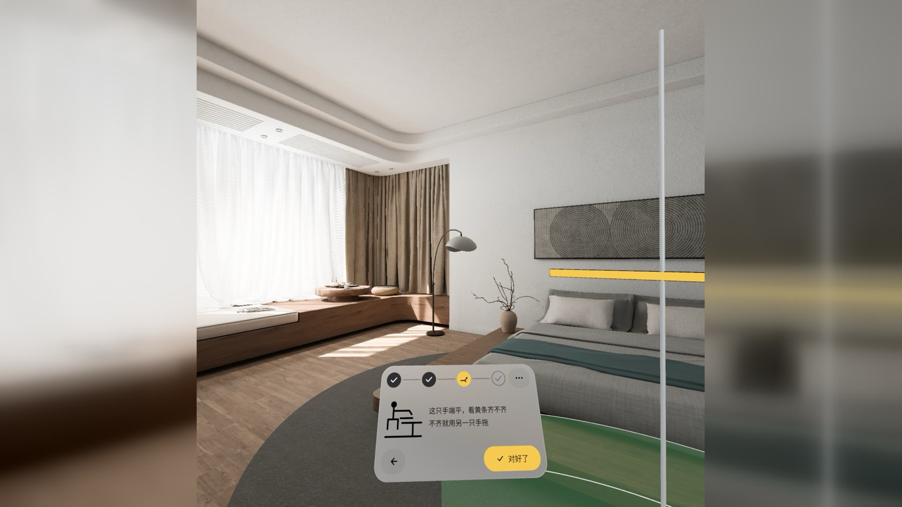
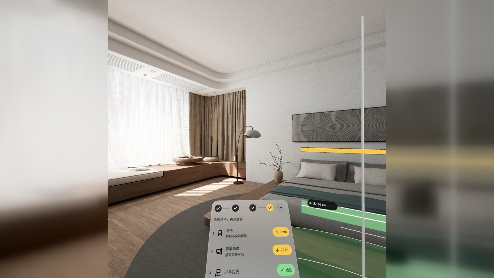

# 工位校准 Desk Fit



**中文** · [English](#english)

PICO 混合现实应用：坐在自己的书桌前戴 5 分钟，**量出你本人坐在这把椅子上的眼高**，把一根黄尺套到你的真显示器上，再端平一只手臂比一比桌沿——它告诉你椅子该升几厘米、屏幕该抬几厘米、推远还是拉近。判定规则来自 OSHA 计算机工位指南（屏距 50–100 cm、屏幕上沿与眼平齐或略低、前臂与地面平行）。

- 下载：[Releases · v0.1.0](https://github.com/kejing-dev/DeskFit/releases/tag/v0.1.0)（`DeskFit-v0.1.0.apk`）
- 设备：PICO OS 6（Spatial SDK 6.1.9），Full Space · 混合现实（透视），平面识别
- 不联网、不需要账号、不要 API key；中英双语，单位 cm / in；最近 5 次结果存在本机

## 截图

> 以下都是 PICO 模拟器截图（中文界面，部分状态由调试广播跳到；模拟器里真桌子在 3–5 m 外，所以用的是合成桌面），**不是真机画面**。原图 2160×2158 方图，居中补背景合成 16:9，没有拉伸。

| | |
|---|---|
|  |  |
| **第 1 步 · 坐好**：像平时打字那样坐，看前方，按 [坐好了]，1.4 s 采你的眼高 | **第 2 步 a · 点屏幕正下方的桌面**：桌面上画出 50 / 75 / 100 cm 三道屏距弧，绿扇形是合格区 |
|  |  |
| **第 2 步 b · 黄条拖到屏幕上沿**：点中处升起一根杆，把黄横条拖到真显示器的上沿；摇杆左右能转它 | **第 3 步 · 端平前臂**：桌沿上出现一根黄前臂条，这只手端平，不齐就用另一只手拖 |
|  |  |
| **结果**：先调椅子再调屏幕——椅子 ↑7 cm（脚踩不实加脚踏）、屏幕 ↓22 cm（按调完椅子后）、屏距合适；杆上的绿带就是目标高度 | **扫不到桌面时**：把板子拖到桌面高，再点一下桌沿，流程照常走下去 |

## 怎么用

1. 坐在自己的桌前、自己的椅子上，打开应用。应用认出地面和桌面后进入「坐好」。
2. 按 [坐好了]，别动 1.4 s：头显在地面之上的高度就是你的坐姿眼高。
3. 点显示器正下方的桌面 → 一根杆升起来；把黄横条拖到屏幕上沿（晃晃头，黄条还贴着就对了）。
4. 一只手前臂端平跨过桌沿，看黄前臂条齐不齐，不齐用另一只手拖，按 [对好了]。
5. 读数卡给三条建议：椅子、屏幕高度、屏幕距离。摘下头显照做，再戴上「再量一次」，尺带缩到 0、三行变绿就对了。

更多菜单（面板右上 …）：中文 / EN、cm / in、重新开始、退出。

## 安装

```bash
adb install -r DeskFit-v0.1.0.apk
pico-cli app launch io.embodit.deskfit
```

包名 `io.embodit.deskfit`，versionName 0.1.0 / versionCode 2（debug 构建，只用于评审和体验）。

## 已知情况（v0.1.0）

- 截图来自模拟器 + 调试输入；演示视频（Release 附件）是英文界面、调试输入驱动、无声，**非真实手势录像**。
- 真机（PICO B3110，PICO OS 6.2.0）上装过、冷启动过：真实房间 13 块平面，桌面 0.76 m 一启动就认出来进入「坐好」；之后的坐姿采样、拖黄条、拖前臂条、摇杆转尺还没有人戴着头显逐步验过。
- 眼手（注视 + 捏合）模式下，点桌面前没有落点十字预览（系统指点只在点击时给落点）；手柄射线有。
- 懒跟随的步骤面板按水平正前方摆放：抬着头启动时面板在视线下方、视野外，回到平视就看见了。
- 退出键是纯图标按钮（更多菜单最后一项）；退出没有二次确认。
- 中文只带 Noto Sans SC Regular 一个字重；屏距弧不按桌面四边形裁剪。

## 开发

Kotlin + PICO Spatial SDK 6.1.9，一个混合现实 Stage（Full Space，透视），SpatialUI 面板，不用 Material。状态机、调试广播和 QA 钩子见 [AGENTS.md](AGENTS.md)。字体 Noto Sans / Noto Sans SC（SIL OFL 1.1，见 `third_party/`）。

---

<a id="english"></a>

# Desk Fit (工位校准)

[中文](#工位校准-desk-fit) · **English**

A PICO mixed-reality app: sit at your own desk for five minutes and it **measures your seated eye height**, fits a yellow ruler onto your real monitor, then lets you level a forearm against the desk edge — and tells you how many centimetres to raise the chair, raise the screen, and whether to push it away or pull it closer. The rules follow the OSHA computer-workstation guidance (screen 50–100 cm away, top of screen at or slightly below eye level, forearms parallel to the floor).

- Download: [Releases · v0.1.0](https://github.com/kejing-dev/DeskFit/releases/tag/v0.1.0) (`DeskFit-v0.1.0.apk`)
- Device: PICO OS 6 (Spatial SDK 6.1.9), Full Space · mixed reality (passthrough), plane detection
- Offline, no account, no API key; Chinese and English UI, cm / in; last 5 results kept on device

## Screenshots

> All screenshots come from the PICO emulator (Chinese UI; some states reached through the debug broadcast; the emulator's tables are 3–5 m away, so a synthetic desk is used). **Not headset footage.** Originals are 2160×2158 squares, centred on a padded 16:9 background, never stretched. See the table above:

1. **Step 1 · Sit** — sit as you type, look ahead, press [Ready]; 1.4 s eye-height sample
2. **Step 2a · Tap the desk under the screen** — 50 / 75 / 100 cm distance arcs on the desk, the green sector is the good zone
3. **Step 2b · Drag the bar to the screen top** — a pole rises where you tapped; drag the yellow bar to your monitor's top edge (thumbstick turns it)
4. **Step 3 · Level your forearm** — a yellow forearm bar appears at the desk edge; level this arm, drag the bar with the other hand if it does not match
5. **Result** — chair first, then screen: chair ↑7 cm (add a footrest), screen ↓22 cm (after the chair change), distance OK; the green band on the pole is the target
6. **No desk found** — drag the glass plate to desk height, tap the edge, and continue as usual

## How to use

1. Sit at your desk on your own chair and launch the app. Once the floor and desk are recognised it shows "Sit".
2. Press [Ready] and hold still for 1.4 s: the headset's height above the floor plane is your seated eye height.
3. Tap the desk right under the monitor → a pole rises; drag the yellow bar to the top edge of the screen (nod a little — if the bar still sits on the edge, it is right).
4. Hold one forearm level across the desk edge and compare it with the yellow forearm bar; drag the bar with the other hand if needed, then press [Done].
5. The result card gives three recommendations: chair, screen height, screen distance. Take the headset off, adjust, put it on again and "Measure again" — when the tapes shrink to zero and all three rows turn green, you are done.

More menu (… at the top right of the panel): 中文 / EN, cm / in, start over, exit.

## Install

```bash
adb install -r DeskFit-v0.1.0.apk
pico-cli app launch io.embodit.deskfit
```

Package `io.embodit.deskfit`, versionName 0.1.0 / versionCode 2 (debug build, for review and try-out only).

## Known notes (v0.1.0)

- Screenshots are emulator captures driven by debug input; the demo video attached to the Release has an English UI, is driven by debug input and has no audio — **not a real-gesture recording**.
- Installed and cold-started on a PICO B3110 (PICO OS 6.2.0): in a real room it detected 13 planes and the desk at 0.76 m and went straight to "Sit"; the later steps (sampling, dragging the bars, thumbstick turning) have not yet been walked through by someone wearing the headset.
- In gaze + pinch mode there is no hover reticle on the desk before you tap (the system pointer only reports the hit on tap); the controller ray shows one.
- The lazy-follow step panel is placed relative to the horizontal forward direction: if you launch while looking up it sits below your line of sight until you look level again.
- The exit control is an icon-only button (last item of the More menu) with no confirmation.
- Chinese text uses a single weight of Noto Sans SC; the distance arcs are not clipped to the desk outline.

## Development

Kotlin + PICO Spatial SDK 6.1.9, one mixed-reality Stage (Full Space, passthrough), SpatialUI panels, no Material. State machine, debug broadcast and QA hooks are documented in [AGENTS.md](AGENTS.md). Fonts: Noto Sans / Noto Sans SC (SIL OFL 1.1, see `third_party/`).
